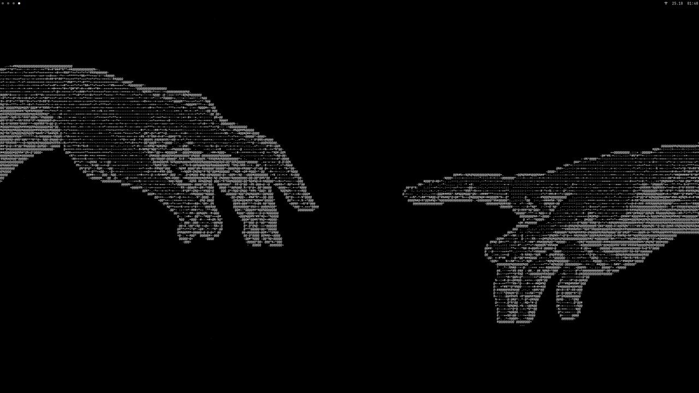

```
         █▄        █▄                  ▄█▀          ▄█▀    ▄█▀█▄ ▄▀▀▄  ▄█▀
         █▓▌       █▓▌                ▐▓█▄         ▐▓█▄▄  █▓▌  █▌▌■▀▐▌▐▓█
   ▄▄██▄▐▓▓█░▄▓▄  ▐▓▓█░▄▓▄        ▄▓▄░▀▓▓▌  ▄▓██▄  ▀▓▓▌  ▐▓▓▄  ▀ ▀■▓▀ ▐▓▓▌      ▄▄█▄▄    ▄▄██▄
  ▓▓  ▀▀▐▒▒ ▀ ▀██ ▐▒▒ ▀ ▀██      ██▀ ▀ ▒▒  ▓▓▀  ▀▓ ▐▒▒    ▒▒▌▀█▄  ▄▄▓▀▐▒▒      ▓█▀ ▀▓▓  ▓▓  ▀▀
   ▀▀▀▄  ░░▌   ▐▓▌ ░░▌   ▐▓▌    ▐▓▌    ░░▌▐▒▌   ▐▓▌ ░░▌  ▐░░  ░   ▐▓▓  ░░▌    ▐▒▌  ▄▒▀   ▀▀▀▄
▐█▌  ░█░ ██▓  ▄██  ██▓  ▄██      ██▄  ▐██ ▐░░▄ ▄▒▒  ▐██  ██▌       ▒▒▌ ▐██   ▄ ▀░░▀   ▐█▌  ░█░
 █░▄██▀  ▐█▌  █▀   ▐█▌  █▀        ▀░█▄██▌  ▀█░█░▀    █░▀▀░█       ▐░░   █░█▄█▀  ▀█▄  ▄ █░▄██▀
  ▀▀░     ▀    ▀    ▀    ▀           ▀▀▀      ▀     ▀      ▀      ██▀    ▀▀▀       ▀▀   ▀▀░
                                                                  ▀▄

                           // quiet  // minimal  // no useless GUI
```



> **🚧 Work in progress.** The installer sets up a fresh system from start to finish;
> configs are still being polished. Tested in a VM and on a real PC.

Dotfiles and an installer for **Artix Linux with the s6 init system**: black and white,
everything in the terminal, no useless GUI.

## Stack

| | |
|---|---|
| distro / init | Artix Linux, s6 (no systemd) |
| login | plain TTY, no display manager; sway starts on tty1 |
| seat | seatd + pam_rundir (no elogind) |
| desktop | sway + swaybar, no XWayland |
| shell / terminal / editor | zsh / foot / neovim |
| launcher, menus | foot + fzf (own scripts) |
| files | broot (a tree) |
| notifications | mako |
| sound | PipeWire + WirePlumber |
| network | iwd + openresolv |
| AUR | yay |
| font | JetBrains Mono Nerd Font |

## Install

Start from a fresh **Artix base install with s6** (pick `seatd-s6`, not elogind), a user
in the `wheel` group and a working internet connection. Then, as that user (**not root**):

```sh
sudo pacman -S git
git clone https://github.com/kiran-why/Shh-dotfiles.git ~/Shh-dotfiles
cd ~/Shh-dotfiles
sh install.sh
```

Reboot and log in on **tty1**: sway starts by itself. Other ttys (`Ctrl+Alt+F2` ...)
stay plain consoles for rescue.

`install.sh` checks the system, adds the Arch `[extra]` repo and `yay`, installs
`packages/common.csv`, enables the s6 services from `services.txt`, sets a few system
options and links the configs with `link.sh`. It is safe to run again, and nothing is
ever deleted: a file in the way is renamed to `name.bak-DATE`.
`sh install.sh --check` only checks that every package exists.

## Layout

```
install.sh link.sh lib.sh   installer, symlinks, shared messages
packages/common.csv         packages: tag,package,description (empty tag = pacman, A = AUR)
services.txt                s6 services
config/     ->  ~/.config/  sway, swaybar, foot, fastfetch, broot, nvim, mako
home/       ->  ~/          .zprofile .zshrc
scripts/    ->  ~/.local/bin/  launcher, volume, wifi, sound, wallpaper, screenshot, autotile
wallpapers/ ->  ~/wallpapers   the newest picture here is the wallpaper (not in git)
```

To change something, edit the file in the repo: the configs in `$HOME` are links to it.

## Keys

`Super` is the Windows key.

| keys | action |
|---|---|
| `Super + T` | terminal (foot) |
| `Super + B` | browser |
| `Super + F` | files (broot) |
| `Super + R` | launcher |
| `Super + Q` | close window |
| `Super + Shift + F` | fullscreen |
| `Super + V` | float / tile |
| `Super + arrows` | move focus |
| `Super + Shift + arrows` | move window |
| `Super + mouse` | drag (left) / resize (right) a window |
| `Super + 1 … 0` | go to workspace |
| `Super + Shift + 1 … 0` | send window to workspace |
| `Super + S` | show / hide scratchpad |
| `Super + Shift + S` | send window to scratchpad |
| `Super + L` | leave the desktop |
| `Print` | screenshot of a region, saved to `~/pictures/screenshots` and copied |
| `Alt + Shift` | switch keyboard layout (us / ru) |

On the bar: click wifi for the network menu, click the volume for the sound menu,
scroll on the volume to change it.

In zsh: `Tab` completes, `→` accepts the gray suggestion, `↑` / `↓` search the history
by what you typed, `Ctrl + ←` / `→` jump by words.

## Known issues / not done yet

- no NVIDIA support (yet)
- wired network needs its own DHCP client: iwd only sets up wifi

## Thanks

Ideas taken from [LARBS](https://github.com/LukeSmithxyz/LARBS) (installer) and
[holman/dotfiles](https://github.com/holman/dotfiles) (symlinks).
