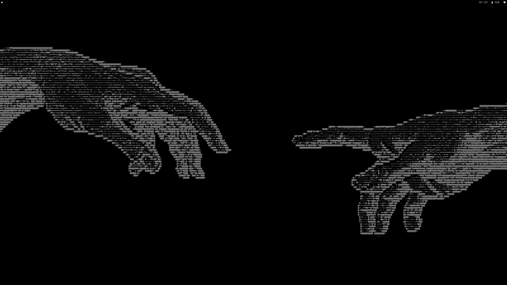
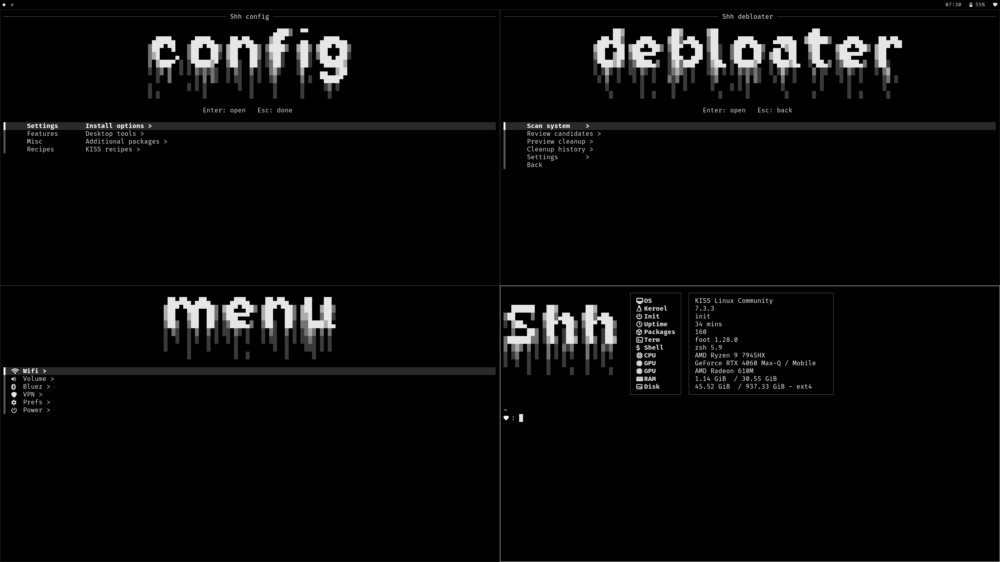

<h1 align="center"></h1>

A terminal-first Sway desktop without systemd. Swaybar shows the workspace and system status. The launcher, settings and desktop menus run in foot.



<a href="assets/menus.png"></a>

## Features

- Use fzf menus to launch programs, switch Wi-Fi networks and select audio devices.
- Choose Vim or Neovim for editing and broot or Yazi for files.
- Enable screenshots, screen recording, clipboard history and automatic tiling individually.

## Shh CLI and system management tools

- `shh config` selects components and settings for the next install or update.
- `shh diff` previews local dotfile changes and backups. `shh update --check` also previews packages and the update plan. Both previews use a local checkout.
- `shh update` updates the system and dotfiles. `shh uninstall --check` previews managed file removals and backup restores.
- `shh doctor --graphics` inspects DRM devices and graphics errors. Other modes check audio, networking, performance, build tools and configuration. `shh report` prints a summary for manual review.
- `shh debloater --scan` lists a summary of cleanup candidates. `shh debloater --check` previews the selected cleanup plan.

The diagnostic and Debloater modules are optional. Run `shh help` for the command list.

## Supported distributions

- Artix Linux with s6
- Void Linux with musl and runit
- KISS Linux Community with runit

## Installation

Start from a base installation with internet access and Git installed. Run the installer as a regular user in the `wheel` group with working `sudo` access.

```sh
git clone https://github.com/kiran-why/Shh-dotfiles.git
cd Shh-dotfiles
sh install.sh
```

Reboot and log in on tty1 to start Sway.

## Website and related projects

- [Shhware](https://shhware.org) · [Keybinds](https://shhware.org/en/projects/shh-dotfiles/keybinds.html) · [Shh commands](https://shhware.org/en/projects/shh-dotfiles/shh.html) · [Components](https://shhware.org/en/projects/shh-dotfiles/components.html) · [Known issues](https://shhware.org/en/projects/shh-dotfiles/known-issues.html)
- [Shhware-utils](https://github.com/kiran-why/Shhware-utils) implements a small set of Unix command-line utilities.
